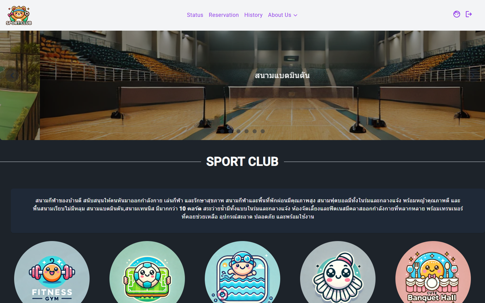
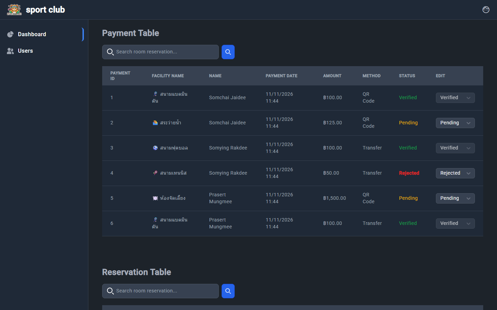
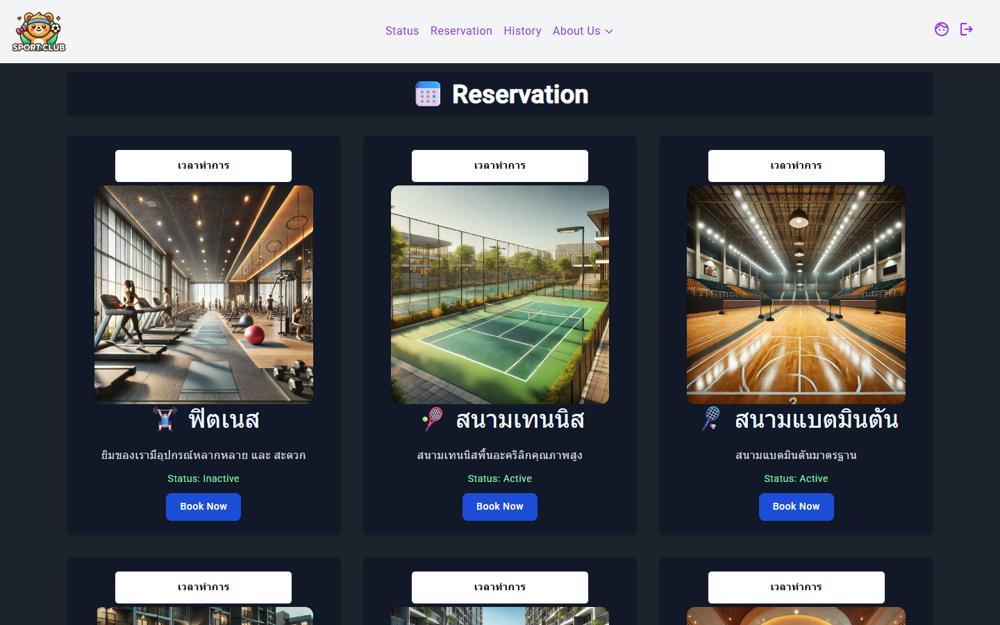
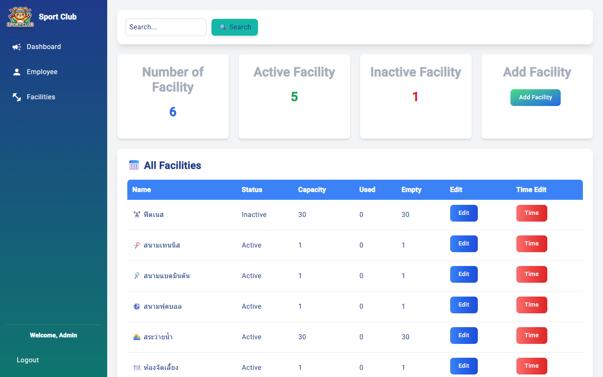
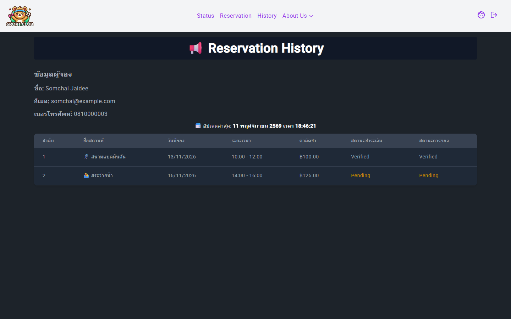
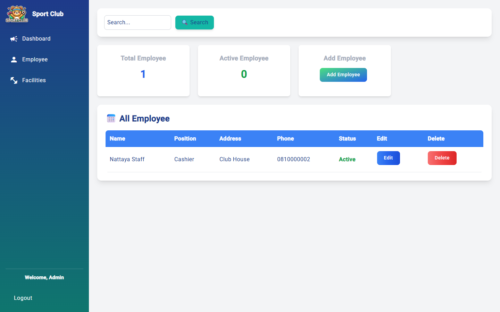

# Village Club House — ระบบจองสิ่งอำนวยความสะดวกของสโมสรหมู่บ้าน

เว็บแอปสำหรับสโมสร (club house) ของหมู่บ้าน ให้สมาชิกดูสถานที่ที่เปิดให้ใช้งาน (สนามแบดมินตัน, ฟุตซอล, สระว่ายน้ำ, ฟิตเนส ฯลฯ) เลือกช่วงเวลาแล้วจอง ชำระค่ามัดจำ และติดตามสถานะการจอง ส่วนฝั่งเจ้าหน้าที่และผู้ดูแลระบบใช้ตรวจสอบการชำระเงิน จัดการพนักงาน และจัดการสถานที่พร้อมตารางเวลา

โปรเจกต์นี้เป็นงานของวิชา [วิศวกรรมซอฟต์แวร์ระบบ](#ที่มาของโปรเจกต์) แยกเป็นหน้าเว็บ Angular และ REST API บน ASP.NET Core เชื่อมกันด้วย JWT

| สมาชิก (member) | เจ้าหน้าที่ / ผู้ดูแล |
|---|---|
|  |  |
|  |  |
|  |  |

## ที่มาของโปรเจกต์

โปรเจกต์นี้เป็นส่วนหนึ่งของวิชา

| รหัสวิชา | วิชา | ส่วนที่เกี่ยวข้องในโปรเจกต์ |
|---|---|---|
| 02739421 | วิศวกรรมซอฟต์แวร์ระบบ (Software Engineering) | การวิเคราะห์ความต้องการและออกแบบระบบจองสถานที่, การแบ่งชั้น Frontend / Backend / Database, การพัฒนาด้วย Git, การจัดการ schema ด้วย EF Core migration |

## ฟีเจอร์

**สมาชิก (member)**
- สมัครสมาชิกและเข้าสู่ระบบ (รหัสผ่านถูกแฮชก่อนเก็บ ไม่เก็บเป็นข้อความธรรมดา)
- ดูรายการสถานที่ รายละเอียด ความจุ และสถานะ (Available หรืออื่นๆ) พร้อมหน้าประกาศสถานะการใช้งาน
- จองสถานที่ เลือกวันที่ ช่วงเวลา และจำนวนชั่วโมง
- ชำระค่ามัดจำ (ระบบคำนวณยอดจากราคาสถานที่ × จำนวนชั่วโมง ที่ฝั่งเซิร์ฟเวอร์ ไม่เชื่อยอดที่หน้าเว็บส่งมา)
- ดูประวัติการจองพร้อมสถานะการชำระเงินและสถานะการจอง
- ดูและแก้ไขข้อมูลส่วนตัว

**เจ้าหน้าที่ (staff)**
- ตารางการชำระเงิน ค้นหาได้ ดูผู้จอง สถานที่ วันที่ ยอด และวิธีชำระ
- เปลี่ยนสถานะการชำระเงินเป็น `Pending`, `Verified` หรือ `Rejected` (บันทึกว่าใครเป็นผู้ตรวจและเวลาใด)
- หน้าจัดการข้อมูลผู้ใช้

**ผู้ดูแลระบบ (admin)**
- ทำสิ่งที่เจ้าหน้าที่ทำได้ทั้งหมด
- จัดการพนักงาน: เพิ่ม ดู แก้ไข ลบ
- จัดการสถานที่: เพิ่ม แก้ไขรายละเอียด/ราคา/ความจุ/รูป และจัดการช่วงเวลาที่เปิดให้จอง (time slot)

**ระบบสิทธิ์**
- JWT หมดอายุ 1 ชั่วโมง มี claim ของ id, ชื่อ, อีเมล และ role
- ฝั่งหน้าเว็บมี route guard ตาม role (`member`, `staff`, `Admin`) และ interceptor แนบ token ให้ทุกคำขอ
- ฝั่ง API ใช้ `[Authorize]` ตรวจ token ในเส้นทางที่เกี่ยวกับข้อมูลส่วนตัวและการเงิน

## เทคโนโลยี

| ส่วน | ใช้ |
|---|---|
| หน้าเว็บ | Angular 18 (SSR), Tailwind CSS 3, Flowbite, DaisyUI, Angular Material, SweetAlert2, Swiper, flatpickr, date-fns, jwt-decode |
| API | ASP.NET Core (.NET 9) Web API, JWT Bearer, Swagger (Swashbuckle), dotenv.net |
| ฐานข้อมูล | Microsoft SQL Server ผ่าน Entity Framework Core 9 (Code-First + Migrations) |

## สถาปัตยกรรมและฐานข้อมูล

```
Angular (4200)  ──HTTP + JWT──▶  ASP.NET Core API (5203)  ──EF Core──▶  SQL Server (SportClub)
   │                                  │
   ├─ user/   สมาชิก                  ├─ Controllers/  User, Employee, Facilities, Reservation, Payment
   ├─ staff/  เจ้าหน้าที่              ├─ Model/        entity + request/response model
   └─ admin/  ผู้ดูแล                 └─ Data/         AppDbContext
```

- **5 ตาราง:** `Users` (สมาชิก พนักงาน และผู้ดูแล แยกด้วย `Role`), `Facilities`, `TimeSlots`, `Reservations`, `Payments`
- **3 view:** `Reservationview`, `PaymentHisView`, `ResView` (map เป็น keyless entity ใน EF Core)
- ความสัมพันธ์: `Reservations` อ้างถึง `Users` และ `Facilities`, `Payments` อ้างถึง `Reservations`, `TimeSlots` อ้างถึง `Facilities`

**วงจรของการจอง:** สมาชิกจอง → การจองสถานะ `Pending` → สมาชิกชำระเงิน → การชำระสถานะ `Pending` → เจ้าหน้าที่ตรวจแล้วเปลี่ยนเป็น `Verified` หรือ `Rejected` และอัปเดตสถานะการจอง

## เริ่มใช้งาน

**ต้องมี:** Node.js และ npm, .NET 9 SDK, SQL Server ที่เปิด TCP (ตัวอย่างพอร์ต 1433) และเครื่องมือ `dotnet-ef`

```bash
dotnet tool install --global dotnet-ef
```

1. **ตั้งค่า API** แก้ [Backend/Clubapi/appsettings.json](Backend/Clubapi/appsettings.json) หรือสร้างไฟล์ `.env` ในโฟลเดอร์ `Backend/Clubapi` ตามตารางด้านล่าง
2. **สร้างฐานข้อมูล** (ใช้ migration ที่มีอยู่)
   ```bash
   cd Backend/Clubapi
   dotnet ef database update
   ```
3. **สร้าง view ทั้ง 3 ตัว** (`Reservationview`, `PaymentHisView`, `ResView`) ในฐานข้อมูลด้วยตนเอง เพราะ migration ยังไม่ได้สร้างให้ ดูหัวข้อ [ข้อจำกัดที่ทราบ](#ข้อจำกัดที่ทราบ)
4. **รัน API** (http://localhost:5203, Swagger อยู่ที่หน้าแรกเมื่อรันแบบ Development)
   ```bash
   dotnet run
   ```
5. **รันหน้าเว็บ** (เปิดเทอร์มินัลใหม่)
   ```bash
   cd VillageClub
   npm install
   npm start                # http://localhost:4200
   ```

**ตัวแปรของ API**

| ตัวแปร / คีย์ | ความหมาย |
|---|---|
| `ConnectionStrings:DefaultConnection` | สตริงเชื่อมต่อ SQL Server (ฐานข้อมูล `SportClub`) |
| `JWT_SECRET_KEY` หรือ `JwtSettings:SecretKey` | ความลับสำหรับเซ็น JWT (ไม่ตั้ง API จะไม่เริ่มทำงาน) |
| `JWT_ISSUER` หรือ `JwtSettings:Issuer` | ผู้ออก token |
| `JWT_AUDIENCE` หรือ `JwtSettings:Audience` | ผู้รับ token |

ค่าใน environment variable หรือ `.env` มีลำดับก่อน `appsettings.json` ที่อยู่ API ที่หน้าเว็บเรียกตั้งไว้ใน [environment.ts](VillageClub/src/environments/environment.ts) (`http://localhost:5203`) CORS อนุญาตเฉพาะ `http://localhost:4200`

> อย่านำรหัสผ่านฐานข้อมูลหรือ JWT secret จริงขึ้น Git ให้เก็บใน `.env` หรือ user-secrets แทน

## โครงสร้างโปรเจกต์

```
.
├─ Backend/Clubapi/            API (ASP.NET Core)
│  ├─ Controllers/             User, Employee, Facilities, Reservation, Payment
│  ├─ Model/                   entity และ request/view model
│  ├─ Data/                    AppDbContext
│  ├─ Migrations/              EF Core migrations
│  └─ Program.cs               JWT, CORS, Swagger, DbContext
└─ VillageClub/                หน้าเว็บ Angular
   ├─ src/app/user/            login, register, home, reservation, status, history
   ├─ src/app/staff/           login, dashboard (ตรวจการชำระ), edit-user
   ├─ src/app/admin/           adminhome, employee-manage, facility
   ├─ src/app/Guard/          auth.guard (ตรวจ login และ role)
   ├─ src/app/Interceptor/    auth.interceptor (แนบ JWT)
   ├─ src/app/Service/        auth.service
   └─ src/app/Model/          interface ของข้อมูล
```

## ภาพรวม API

ทุกเส้นทางขึ้นต้นด้วย `/api/<Controller>`

| กลุ่ม | เส้นทาง (เมธอด) | สิทธิ์ |
|---|---|---|
| ผู้ใช้ | `/User/register` (POST), `/User/login` (POST) | สาธารณะ |
| ผู้ใช้ | `/User/getmy`, `/User/whoami` (GET), `/User/UserEdit` (PUT) | login |
| ผู้ใช้ | `/User/userall` (GET) | Admin |
| ผู้ใช้ (อื่นๆ) | `/User/getUser`, `/User/getUser/{id}` (GET) | ยังไม่จำกัด |
| สถานที่ | `/Facilities/getFacilities`, `/getFacilitiesByName`, `/getTimetable/{facilityId}` (GET) | ยังไม่จำกัด |
| สถานที่ | `/AddFacilities`, `/editFacility/{id}`, `/AddTime`, `/EditTime/{slotId}`, `/DeleteTime/{slotId}` | ยังไม่จำกัด (ใช้ฝั่งผู้ดูแล) |
| การจอง | `/Reservation/reserve` (POST) | login |
| การจอง | `/Reservation/updateStatus/{r_id}` (PUT) | ยังไม่จำกัด |
| การชำระเงิน | `/Payment/pay` (POST), `/Payment/getresavtionhis` (GET) | login |
| การชำระเงิน | `/Payment/Paymentall`, `/getReservationStatusAll` (GET), `/updatePaymentStatus/{pay_ID}` (PUT) | ยังไม่จำกัด (ใช้ฝั่งเจ้าหน้าที่) |
| พนักงาน | `/Employee/add-employee`, `/Empall`, `/employee/{id}`, `/edit-employee/{id}`, `/delete-employee/{id}` | ยังไม่จำกัด (ใช้ฝั่งผู้ดูแล) |

เปิด Swagger (http://localhost:5203) เพื่อดูและทดลองเรียก API ได้ทั้งหมด กด Authorize แล้วใส่ `Bearer {token}`

## ข้อจำกัดที่ทราบ

- **สิทธิ์ฝั่ง API ยังไม่ครบ** เส้นทางของ admin/staff หลายเส้น (จัดการพนักงาน, จัดการสถานที่, ตรวจการชำระ, เปลี่ยนสถานะการจอง) ยังไม่มี `[Authorize(Roles = ...)]` ตอนนี้กันได้เฉพาะที่ route guard ของหน้าเว็บ
- **การแฮชรหัสผ่านใช้ SHA-256 ล้วน ไม่มี salt** ควรเปลี่ยนเป็น bcrypt / Argon2 / ASP.NET Identity PasswordHasher
- **ยังไม่มี migration สำหรับ view** `Reservationview`, `PaymentHisView`, `ResView` ต้องสร้างเอง ถ้าไม่มี API ส่วนประวัติการจองและตารางการชำระเงินจะพัง
- **การจองยังไม่ตรวจเวลาซ้ำ** API ไม่เช็กว่าสถานที่เดียวกันวันและเวลาเดียวกันมีคนจองแล้วหรือยัง
- **ยอดชำระ** คำนวณเป็นราคา × ชั่วโมง ÷ 2 (ค่ามัดจำครึ่งหนึ่ง) ยังไม่มีการอัปโหลดสลิปหรือเชื่อมระบบชำระเงินจริง
- **ข้อมูลบางหน้ายังเป็นตัวอย่าง** เช่น ตัวเลขสรุปในหน้า adminhome และตารางในหน้า edit-user ยังไม่ได้ดึงจาก API
- **ไม่มีชุดทดสอบอัตโนมัติ** มีเฉพาะไฟล์ `.spec.ts` ที่ Angular CLI สร้างให้
- ไฟล์ build ของ .NET (`bin/`, `obj/`) ถูก track ใน Git อยู่ ควรเพิ่มใน `.gitignore` แล้วเอาออกจาก index
- `appsettings.json` มีสตริงเชื่อมต่อและ JWT secret สำหรับเครื่องพัฒนา ควรย้ายไปเก็บนอก Git ก่อนนำไปใช้งานจริง
